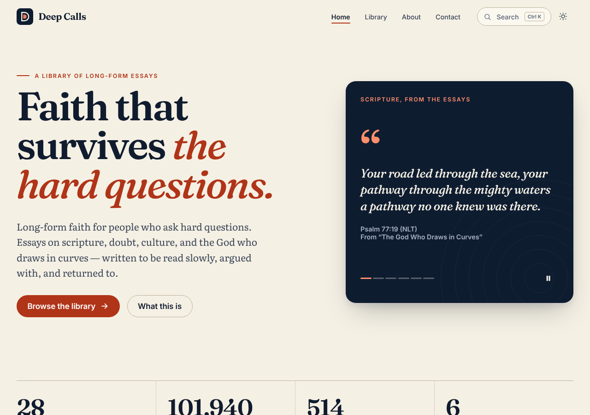

<div align="center">


# Deep Calls

**Long-form faith for people who ask hard questions.**

[](https://github.com/babatundeawo/deep-calls/actions/workflows/deploy.yml)
[](https://github.com/babatundeawo/deep-calls/actions/workflows/codeql.yml)

[Read the essays](https://babatundeawo.github.io/deep-calls/) · [Browse the library](https://babatundeawo.github.io/deep-calls/library.html) · [Get in touch](https://babatundeawo.github.io/deep-calls/contact.html)

<picture>
  <source media="(prefers-color-scheme: dark)" srcset="docs/assets/preview-dark.png">
  
</picture>

</div>

## About

Deep Calls is a library of long-form Christian apologetics essays written from Nigeria for the curious, the skeptical and the tired. Each essay starts with a real question about scripture, doubt, culture or suffering, and takes its time with the answer.

## Features

- 28 essays across six themes, with search (press Ctrl or Cmd + K), filters and sorting
- Calm reading: clear type, contents list, reading progress and estimated reading time
- Listen mode that reads an essay aloud
- Select a passage to copy it as a quote with a link back
- Light and dark themes that follow your device
- Fast, accessible and works without JavaScript
- Print-friendly pages

## How to use

Open **[babatundeawo.github.io/deep-calls](https://babatundeawo.github.io/deep-calls/)** in any browser. Pick an essay from the home page or the library, or press Ctrl/Cmd + K to search.

Have a question or found a mistake? [Open an issue](https://github.com/babatundeawo/deep-calls/issues/new/choose) or use the [contact page](https://babatundeawo.github.io/deep-calls/contact.html).

## Tech stack

Python and Markdown generate a plain HTML, CSS and JavaScript site, with no framework and no tracking. It is built and published by GitHub Actions to GitHub Pages. Fonts (Fraunces, Literata, Inter) are self-hosted.

## Project structure

```text
content/    the essays, one Markdown file each
assets/     styles, scripts and fonts
scripts/    the site generator and quality checks
docs/       guides for the site owner
.github/    automated build, deploy and security checks
```

Guides for the owner: [deploying](docs/DEPLOYMENT.md) and [customizing](docs/CUSTOMIZING.md).

## Contributing

Corrections and topic suggestions are welcome. See [CONTRIBUTING.md](CONTRIBUTING.md).

## Security

See [SECURITY.md](SECURITY.md) to report a concern.

## License and credits

Essay text and site design © Babatunde Awoyemi. All rights reserved. Fonts are used under the SIL Open Font License; licences are in [`assets/fonts`](assets/fonts).

## Contact

babatundeawoyemi91@gmail.com · [@babatundeawo](https://github.com/babatundeawo)
